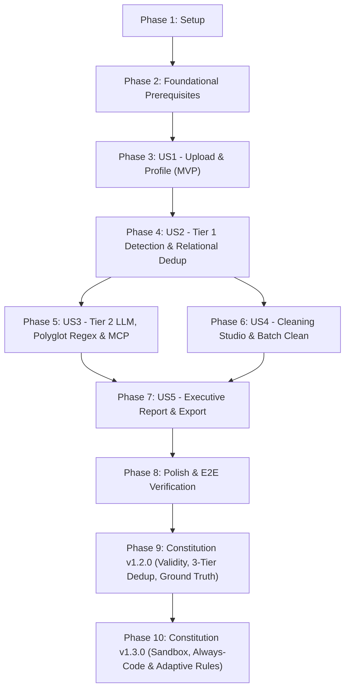

# Tasks: AI Data Quality & Anomaly Detection Agent

**Input**: Design documents from `specs/001-data-quality-anomaly-agent/`  
**Prerequisites**: `plan.md`, `spec.md`, `research.md`, `data-model.md`, `contracts/`, `quickstart.md`  
**Constitution Requirements**: TDD Mandatory (Principle I), Observability-First (Principle II), API-Contract-First (Principle III), Modular Boundaries (Principle IV), Performance SLAs (Principle V), Security by Default (Principle VI), Two-Tier Architecture & Rule-Based Validity (Principle VII), Relational Deduplication 3-Tier (Principle VIII), Business Accessibility & MCP (Principle IX), Non-Destructive Remediation & Exact Recalculation (Principle X), Calibrated Transparent Scoring & Ground Truth (Principle XI).  
**Organization**: Tasks are grouped by phase and user story to enable independent implementation and testing.

---

## Format: `[ID] [P?] [Story] Description`

- **[P]**: Can run in parallel (different files, no dependencies)
- **[Story]**: Which user story this task belongs to (US1, US2, US3, US4, US5)
- Every task includes an exact file path

---

## Phase 1: Setup (Shared Infrastructure)

**Purpose**: Project initialization, directory structure, dependencies, and base configuration.

- [x] T001 Create backend and frontend project directory trees per plan.md in `backend/` and `frontend/`
- [x] T002 [P] Create backend dependency manifests in `backend/requirements.txt` and `backend/requirements-dev.txt`
- [x] T003 [P] Create backend environment template in `backend/.env.example` and `.gitignore` at repository root
- [x] T004 [P] Initialize frontend React + Vite + Tailwind/CSS project configuration in `frontend/package.json` and `frontend/vite.config.js`
- [x] T005 [P] Setup sample datasets and evaluation fixtures in `datasets/online_store_orders_sample.csv`

---

## Phase 2: Foundational (Blocking Prerequisites)

**Purpose**: Core infrastructure, data models, error handling, session management, and contract testing framework that MUST be complete before ANY user story can be implemented.

- [x] T006 [P] Implement shared Pydantic schemas in `backend/app/models/dataset.py`, `backend/app/models/profile.py`, and `backend/app/models/finding.py`
- [x] T007 [P] Implement shared Pydantic schemas in `backend/app/models/score.py`, `backend/app/models/explanation.py`, `backend/app/models/cleaning.py`, and `backend/app/models/report.py`
- [x] T008 [P] Implement in-process thread-safe session store in `backend/app/utils/session.py`
- [x] T009 [P] Implement CSV formula injection guard in `backend/app/utils/formula_guard.py`
- [x] T010 [P] Implement PII masking utility (email/phone) in `backend/app/utils/pii_masker.py`
- [x] T011 Implement FastAPI application factory with structured JSON logging, CORS, and `/health` route in `backend/app/main.py`
- [x] T012 [P] Create frontend API client wrapper with Axios in `frontend/src/services/api.js`
- [x] T013 [P] Setup contract validation test suite asserting OpenAPI compliance in `backend/tests/contract/test_openapi_contract.py`

**Checkpoint**: Foundation ready — user story implementation can now begin.

---

## Phase 3: User Story 1 — Upload and Profile a Dataset (Priority: P1) 🎯 MVP

**Goal**: Allow users to upload a CSV file (up to ~10,000–50,000 rows), validate it, parse encoding/delimiter, and compute rich column-by-column profiles with type inference, distribution statistics, and mini-charts.

- [x] T014 [P] [US1] Unit tests for CSV ingestion, size limits, and encoding detection in `backend/tests/unit/services/test_ingestion.py`
- [x] T015 [P] [US1] Unit tests for column type inference and statistical profiling in `backend/tests/unit/services/test_profiler.py`
- [x] T016 [P] [US1] Integration test for upload and profiling flow in `backend/tests/integration/test_upload_profile.py`
- [x] T017 [US1] Implement CSV ingestion service (MIME validation, row limits, encoding fallback) in `backend/app/services/ingestion.py`
- [x] T018 [US1] Implement column profiler service (semantic type inference, summary stats, distributions) in `backend/app/services/profiler.py`
- [x] T019 [US1] Implement upload router `POST /upload` in `backend/app/routers/upload.py`
- [x] T020 [US1] Implement profile router `GET /sessions/{id}/profile` in `backend/app/routers/profile.py`
- [x] T021 [P] [US1] Create frontend Upload drag-and-drop component in `frontend/src/pages/App.jsx`
- [x] T022 [P] [US1] Create frontend Column Profile summary view and mini completeness charts in `frontend/src/pages/App.jsx`
- [x] T023 [US1] Integrate Upload and Profile views into main user journey in `frontend/src/pages/App.jsx`

---

## Phase 4: User Story 2 — Tier 1 Deterministic Detection & Relational Deduplication (Priority: P1)

**Goal**: Execute deterministic anomaly detectors across missing values, exact duplicates, relational entity deduplication, numeric outliers (IQR + MAD), impossible numbers, and cross-column arithmetic checks.

- [x] T024 [P] [US2] Unit tests for missing values detector (nulls, whitespace, sentinels) in `backend/tests/unit/detectors/test_missing.py`
- [x] T025 [P] [US2] Unit tests for duplicates detector (exact row hash, candidate key blocking) in `backend/tests/unit/detectors/test_duplicates.py`
- [x] T026 [P] [US2] Unit tests for outlier detector (IQR, MAD edge cases) in `backend/tests/unit/detectors/test_outliers.py`
- [x] T027 [P] [US2] Unit tests for inconsistent value detector (canonical matching, RapidFuzz) in `backend/tests/unit/detectors/test_inconsistent.py`
- [x] T028 [P] [US2] Unit tests for quality scoring formula in `backend/tests/unit/services/test_scorer.py`
- [x] T029 [P] [US2] Integration test for detection and scoring pipeline in `backend/tests/integration/test_detect_score.py`
- [x] T069 [P] [US2] Unit tests for key auto-inference and relational deduplication in `backend/tests/unit/detectors/test_relational_duplicates.py`
- [x] T070 [P] [US2] Unit tests for arithmetic consistency check (`qty * unit_price == total_amount` with $\pm 0.01$ tolerance) in `backend/tests/unit/detectors/test_arithmetic_validation.py`
- [x] T030 [P] [US2] Implement abstract detector base class in `backend/app/detectors/base.py`
- [x] T031 [P] [US2] Implement missing values detector in `backend/app/detectors/missing.py`
- [x] T032 [P] [US2] Implement duplicate records detector in `backend/app/detectors/duplicates.py`
- [x] T033 [P] [US2] Implement numeric outliers detector (IQR + Modified Z-score/MAD) in `backend/app/detectors/outliers.py`
- [x] T034 [P] [US2] Implement inconsistent values detector using normalization + RapidFuzz in `backend/app/detectors/inconsistent.py`
- [x] T035 [US2] Implement deterministic quality scoring service in `backend/app/services/scorer.py`
- [x] T036 [US2] Implement detection router `POST /sessions/{id}/detect` and score router `GET /sessions/{id}/score` in `backend/app/routers/detect.py` and `backend/app/routers/score.py`
- [x] T037 [P] [US2] Create frontend Findings Explorer component with filters and row evidence in `frontend/src/pages/App.jsx`
- [x] T038 [P] [US2] Create frontend Quality Score gauge and column breakdown in `frontend/src/pages/App.jsx`
- [x] T039 [US2] Integrate Findings Explorer and Quality Score cards into `frontend/src/pages/App.jsx`
- [x] T071 [US2] Implement key auto-inference heuristics and relational entity deduplication in `backend/app/detectors/duplicates.py`
- [x] T072 [US2] Implement arithmetic consistency check detector with $\pm 0.01$ tolerance in `backend/app/detectors/validation.py`
- [x] T073 [US2] Update detection router to accept `primary_key`, `entity_key`, and `arithmetic_tolerance` parameters in `backend/app/routers/detect.py`
- [x] T074 [P] [US2] Add candidate key selector dropdowns and arithmetic conflict badges in `frontend/src/pages/App.jsx`

---

## Phase 5: User Story 3 — Tier 2 Cognitive LLM, Polyglot Regex & MCP Action Blueprints (Priority: P2)

**Goal**: Integrate LLM cognitive layer to generate structured plain-language explanations, executable pandas code snippets, Core Triad polyglot regex patterns, and standard MCP-ready action blueprints with reversible rollbacks.

- [x] T040 [P] [US3] Unit tests for PII masking before prompt generation in `backend/tests/unit/utils/test_pii_masker.py`
- [x] T041 [P] [US3] Unit tests for LLM response schema validation and fallback template rendering in `backend/tests/unit/services/test_explainer.py`
- [x] T042 [P] [US3] Integration test for explanations endpoint in `backend/tests/integration/test_explain.py`
- [x] T075 [P] [US3] Unit tests for MCP action blueprint schema validation and Core Triad polyglot regex recommendations in `backend/tests/unit/services/test_mcp_polyglot_explainer.py`
- [x] T043 [US3] Implement LLM provider adapter interface and direct REST implementation in `backend/app/services/explainer.py`
- [x] T044 [US3] Implement explainer service with PII sanitization and deterministic fallback in `backend/app/services/explainer.py`
- [x] T045 [US3] Implement explain router `GET /sessions/{id}/explain` in `backend/app/routers/explain.py`
- [x] T046 [P] [US3] Create frontend AI Explanation drawer/card component with badge in `frontend/src/pages/App.jsx`
- [x] T047 [US3] Integrate Explanation view into Findings Explorer in `frontend/src/pages/App.jsx`
- [x] T076 [US3] Update explanation domain models with `MCPActionBlueprint`, `PolyglotRegexInfo`, and `pandas_code` in `backend/app/models/explanation.py`
- [x] T077 [US3] Update explainer service and fallback templates to generate standard MCP actions with rollbacks and Core Triad regex in `backend/app/services/explainer.py`
- [x] T078 [P] [US3] Add MCP Action Blueprint cards and Polyglot Regex badges to Findings Explorer in `frontend/src/pages/App.jsx`

---

## Phase 6: User Story 4 — Human-in-the-Loop Cleaning Studio & Batch Safe Clean (Priority: P2)

**Goal**: Human-in-the-loop cleaning studio with row-level preview diff, granular single/bulk approval, 1-click "Apply All Low-Risk" shortcut, execution on working copy, undo capability, and transformation logging.

- [x] T048 [P] [US4] Unit tests for cleaning operations in `backend/app/services/cleaner.py`
- [x] T049 [P] [US4] Unit tests for preview diff and undo mechanism in `backend/app/services/cleaner.py`
- [x] T050 [P] [US4] Integration test for cleaning lifecycle in `backend/app/routers/clean.py`
- [x] T079 [P] [US4] Unit tests for operation risk classification and batch low-risk clean endpoint in `backend/tests/unit/services/test_batch_clean.py`
- [x] T051 [US4] Implement cleaning engine with preview generator, reversible transformations, and logging in `backend/app/services/cleaner.py`
- [x] T052 [US4] Implement cleaning router `GET /clean`, `GET /clean/preview`, `POST /clean/approve`, `POST /clean/undo` in `backend/app/routers/clean.py`
- [x] T053 [P] [US4] Create frontend Cleaning Studio component with before/after diff table in `frontend/src/pages/App.jsx`
- [x] T054 [P] [US4] Implement approve, bulk-approve, and undo actions in `frontend/src/pages/App.jsx`
- [x] T055 [US4] Connect Cleaning Studio with Quality Score updates in `frontend/src/pages/App.jsx`
- [x] T080 [US4] Update cleaning operation model with `risk_level` and implement low-risk filtering in `backend/app/models/cleaning.py` and `backend/app/services/cleaner.py`
- [x] T081 [US4] Implement `POST /sessions/{id}/clean/apply-all-low-risk` endpoint in `backend/app/routers/clean.py`
- [x] T082 [P] [US4] Add "Apply All Low-Risk" 1-click batch button and risk level badges in `frontend/src/pages/App.jsx`

---

## Phase 7: User Story 5 — Executive Quality Reporting & Sanitized Export (Priority: P3)

**Goal**: Generate standalone executive HTML report and export cleaned CSV with formula-injection guards and comparison of before/after scores.

- [x] T056 [P] [US5] Unit tests for HTML report generation template in `backend/app/services/reporter.py`
- [x] T057 [P] [US5] Unit tests for CSV formula guard export in `backend/app/utils/formula_guard.py`
- [x] T058 [P] [US5] Integration test for report download and CSV export endpoints in `backend/app/routers/report.py`
- [x] T059 [US5] Create self-contained Jinja2 HTML report template with inline styling in `backend/app/templates/report.html`
- [x] T060 [US5] Implement report builder and CSV export service in `backend/app/services/reporter.py`
- [x] T061 [US5] Implement report router `GET /sessions/{id}/report` and CSV export `GET /sessions/{id}/export/csv` in `backend/app/routers/report.py`
- [x] T062 [P] [US5] Create frontend Export / Report download screen in `frontend/src/pages/App.jsx`
- [x] T063 [US5] Integrate Export screen into `frontend/src/pages/App.jsx`

---

## Phase 8: Polish, Performance & Verification

- [x] T064 [P] Implement performance benchmark tests verifying latency SLAs on 10k rows in `backend/tests/integration/`
- [x] T065 [P] Create evaluation script computing precision, recall, and F1 per issue family in `backend/datasets/`
- [x] T066 [P] Add structured logging and request ID correlation middleware in `backend/app/main.py`
- [x] T067 [P] Author comprehensive README with setup instructions, architecture diagram, score formula, and judge demo steps in `README.md`
- [x] T068 Execute full quickstart validation scenarios following `specs/001-data-quality-anomaly-agent/quickstart.md`
- [x] T083 [P] Update planted anomaly dataset fixture with multi-date customer repeat orders, key conflicts, and arithmetic errors in `datasets/online_store_orders_sample.csv`
- [x] T084 Run full test suite with coverage report verifying 100% green tests in `backend/tests/`
- [x] T085 Run end-to-end quickstart validation for all 5 updated scenarios in `specs/001-data-quality-anomaly-agent/quickstart.md`

---

## Phase 9: Constitution v1.2.0 Deliverables (Validity, 3-Tier Dedup, Honest Studio & Ground Truth)

**Purpose**: Execute the new constitutional requirements mandated by Constitution v1.2.0: rule-based validity detector, 3-tier duplicate classifier, honest non-destructive remediation rules, dual-bucket studio UI, calibrated scoring weights, and automated N of N ground truth testing.

### Tests for Constitution v1.2.0 (TDD) ⚠️

- [x] T086 [P] [US2] Author unit tests for Rule-Based Validity Detector (explicit dayfirst date parsing, calendar-impossible dates like 2026-02-30, out-of-range dates, phone formatting/0000000000, email syntax, rating bounds [1-5], delivery days >= 0, quantity > 0) in `backend/tests/unit/detectors/test_validity.py`
- [x] T087 [P] [US2] Author unit tests for 3-Tier Duplicate Classification (exact duplicates as auto-drop, ID collisions as manual review, repeat customers as 'not an issue') in `backend/tests/unit/detectors/test_three_tier_duplicates.py`
- [x] T088 [P] [US4] Author unit tests for honest remediation rules (exact total_amount = qty * price recomputation; rating/email/phone preserved as null rather than synthetic placeholders; outlier flagging) in `backend/tests/unit/services/test_honest_remediation.py`
- [x] T089 [P] [US2] Author automated Ground Truth Benchmark test asserting detection of N of N planted issues on `datasets/online_store_orders_sample.csv` in `backend/tests/unit/detectors/test_ground_truth.py`

### Implementation for Constitution v1.2.0

- [x] T090 [US2] Implement `ValidityDetector` in `backend/app/detectors/validity.py` covering dates (dayfirst=True), impossible dates, phone, email, rating range [1-5], delivery days >= 0, and quantity > 0
- [x] T091 [US2] Update `DuplicateDetector` in `backend/app/detectors/duplicates.py` to classify duplicates into Tier A (exact duplicate), Tier B (key collision for manual review), and Tier C (repeat customer as 'not an issue')
- [x] T092 [US2] Integrate `ValidityDetector` and 3-Tier duplicate classification into `backend/app/routers/detect.py`
- [x] T093 [US2] Update `ScorerService` in `backend/app/services/scorer.py` with calibrated weights: Arithmetic (2.0), Invalid (1.5), Missing (1.0), Duplicate (1.0), Inconsistent (0.5)
- [x] T094 [US4] Update `CleaningService` in `backend/app/services/cleaner.py` to enforce exact arithmetic recalculation (`total_amount = qty * price`), preserve nulls for rating/email/phone, flag outliers, and partition operations into `auto_fixable` vs `needs_review`
- [x] T095 [P] [US4] Update Cleaning Studio in `frontend/src/pages/App.jsx` to render dual buckets: **"Auto-Fixable Operations"** vs **"Needs Human Review"**
- [x] T096 [P] [US2] Add visible Scoring Weights Table and Repeat Customer ("Not an Issue") display in `frontend/src/pages/App.jsx` and `backend/app/templates/report.html`
- [x] T097 [Polish] Run full test suite including ground truth benchmark test and verify 100% green tests in `backend/tests/`
- [x] T098 [Polish] Update `README.md` and project documentation with the validity detector, 3-tier duplicate classification, and scoring weights table

---

## Phase 10: Constitution v1.3.0 Deliverables (Visual Sandbox, Always-Code & Adaptive Rule Synthesis Engine)

**Purpose**: Execute the constitutional requirements mandated by Constitution v1.3.0: Interactive Visual Sandbox with side-by-side diffs, Mandatory Always-Code Generation for every cleaning transformation, and an Adaptive Rule Synthesis Engine that identifies unscripted anomalies, synthesizes new detection code, and updates the persistent codebase.

### Tests for Constitution v1.3.0 (TDD) ⚠️

- [x] T099 [P] [US4] Author unit tests for Mandatory Executable Code Generation asserting valid, self-contained Python/pandas snippets for all cleaning operations in `backend/tests/unit/services/test_always_code.py`
- [x] T100 [P] [US4] Author unit tests for Interactive Visual Sandbox diff generation asserting side-by-side before/after cell diffs and dual-bucket assignment in `backend/tests/unit/services/test_visual_sandbox.py`
- [x] T101 [P] [US6] Author unit tests for Dynamic Rule Registry asserting loading, persistence, and unicity in `backend/tests/unit/detectors/test_detector_registry.py`
- [x] T102 [P] [US6] Author unit tests for Adaptive Rule Synthesizer asserting novel pattern discovery, rule synthesis, and zero-false-positive safety checks in `backend/tests/unit/services/test_adaptive_synthesizer.py`
- [x] T103 [P] [US6] Author integration test for Adaptive Learning endpoint `POST /sessions/{id}/adaptive-learn` in `backend/tests/integration/test_adaptive_learning.py`

### Backend Implementation for Constitution v1.3.0

- [x] T104 [US6] Implement `DetectorRegistry` and persistent JSON rule storage in `backend/app/detectors/registry.py` and `backend/app/detectors/custom_rules.json`
- [x] T105 [US6] Implement `AdaptiveRuleSynthesizer` with zero-false-positive safety validation in `backend/app/services/synthesizer.py`
- [x] T106 [US4] Update `CleaningService` in `backend/app/services/cleaner.py` to always generate self-contained executable Python/pandas code snippets (`pandas_code`) and side-by-side sandbox diffs
- [x] T107 [US6] Implement adaptive learn router `POST /sessions/{id}/adaptive-learn` in `backend/app/routers/adaptive.py` and register it in `backend/app/main.py`
- [x] T108 [US6] Wire `DetectorRegistry` into `backend/app/routers/detect.py` to automatically execute dynamically registered rules on standard scans

### Frontend & UI Implementation for Constitution v1.3.0

- [x] T109 [P] [US4] Update Cleaning Studio in `frontend/src/pages/App.jsx` to render an Interactive Visual Sandbox with side-by-side before/after diffs, cell highlighting, and 1-click executable pandas code copying
- [x] T110 [P] [US6] Add "Discover & Synthesize Novel Rules" button, synthesized rule cards, and continuous-learning status indicators in `frontend/src/pages/App.jsx`
- [x] T111 [P] [US6] Add `adaptiveLearn` API client method in `frontend/src/services/api.js`

### Polish & Verification

- [x] T112 [Polish] Run full automated test suite verifying 100% green tests across unit, integration, contract, and ground truth tests (`pytest`)
- [x] T113 [Polish] Update `README.md` and project documentation to showcase the Interactive Visual Sandbox, Always-Code Transparency, and Adaptive Rule Synthesis Engine

---

## Dependencies & Execution Order

---

## Parallel Execution Opportunities (Phase 10)

- `T099`, `T100`, `T101`, `T102`, and `T103` (test suite) touch distinct test files and can be authored in parallel following TDD.
- `T104` (`registry.py`), `T105` (`synthesizer.py`), and `T106` (`cleaner.py`) touch separate backend service modules and can be implemented concurrently.
- `T109` (visual sandbox UI) and `T110` (adaptive learning UI) in `frontend/src/pages/App.jsx` can be authored in parallel with backend endpoint wiring.

---

## Parallel Execution Opportunities (Phase 9)

- `T086`, `T087`, `T088`, and `T089` (unit and ground truth tests) touch distinct test files and can be authored in parallel following TDD.
- `T090` (`validity.py`), `T091` (`duplicates.py`), `T093` (`scorer.py`), and `T094` (`cleaner.py`) touch separate backend modules and can be implemented concurrently.
- `T095` (dual-bucket studio UI) and `T096` (weights table UI) can be styled in `frontend/src/pages/App.jsx` once backend contracts are in place.
